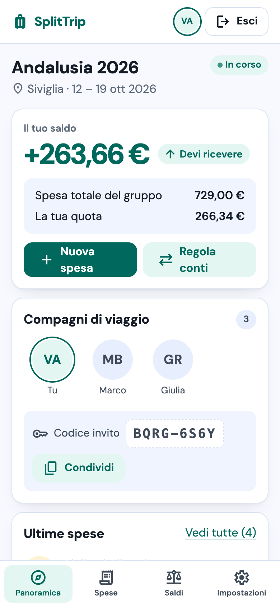
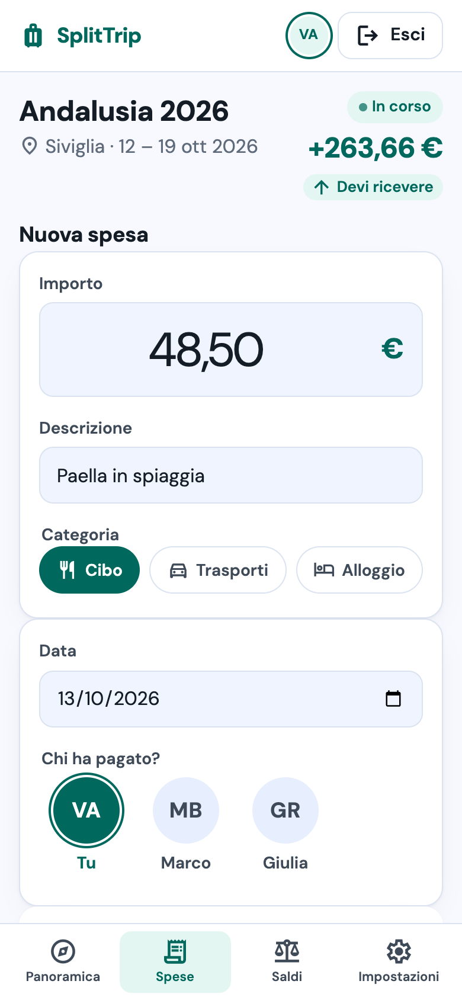
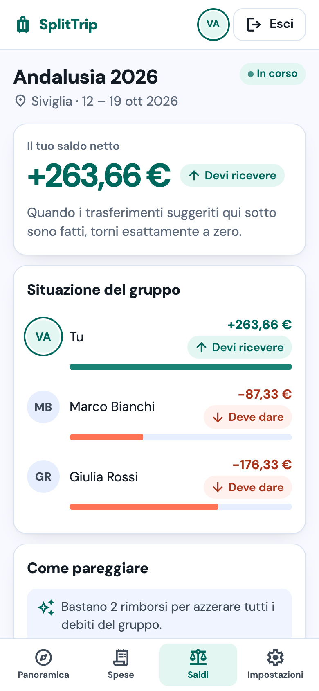
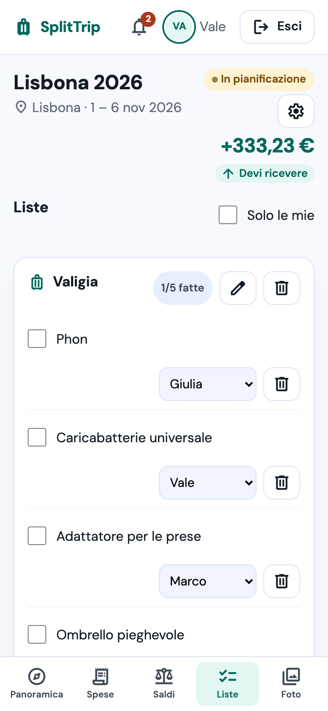
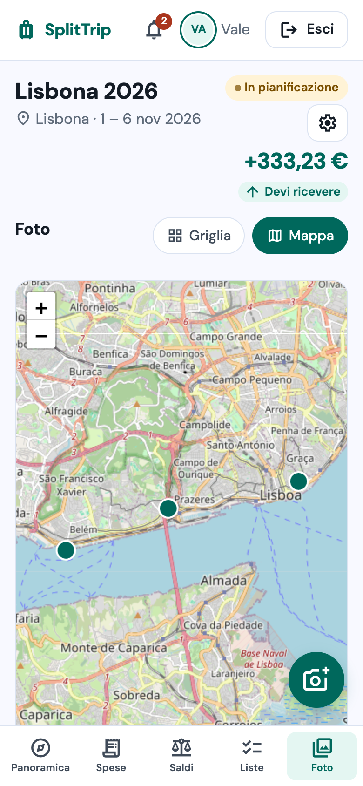
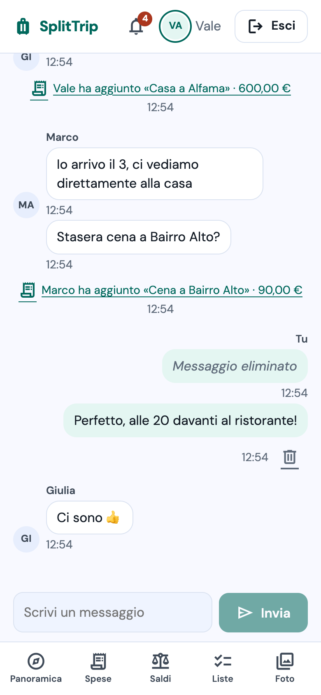
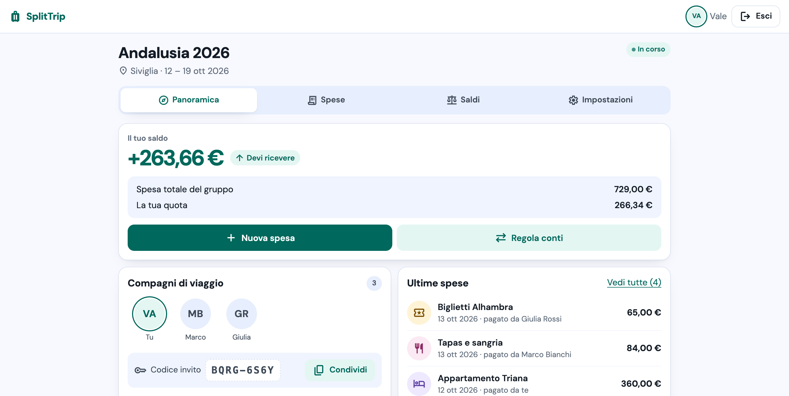

# 🧳 SplitTrip

> **Accompagnare i gruppi di amici in ogni fase della vacanza:** pianificare insieme prima di partire, tenere traccia di spese e cose da fare durante, e ritrovarsi con ricordi condivisi e conti chiari al ritorno.

🔗 **Demo:** https://splittrip-750q.onrender.com
📘 **API (Swagger):** https://splittrip-api.onrender.com/swagger-ui.html

> ⏳ Il backend gira sul piano gratuito di Render: dopo un periodo di inattività si addormenta e la **prima richiesta può impiegare fino a un minuto**. L'app lo segnala con un avviso «Il server si sta svegliando…».

Progetto finale (capstone) del corso fullstack: frontend React + TypeScript, backend Java Spring Boot, PostgreSQL.

---

## ✨ Cosa fa

- 🔐 **Registrazione e login** con JWT
- ✈️ **Viaggi** con stato (in pianificazione → in corso → chiuso) e **codice invito** da condividere su WhatsApp
- 💸 **Spese** divise in parti uguali (dove qualcuno può **contare per 2**, la coppia con un solo telefono, **o per ½**, il bambino), con importi personalizzati o **per presenza** (notti o giorni: chi arriva dopo paga meno alloggio), con l'anteprima delle quote
- 👵 **Partecipanti senza account**: l'organizzatore aggiunge chi non usa l'app, che ha comunque la sua quota; se poi si registra, entrando col codice **rivendica il suo posto** e ritrova le sue spese
- 🧳 **La mia partecipazione**: ognuno imposta per quante persone conta e le date di arrivo e partenza, o lascia il viaggio senza perdere lo storico
- ⚖️ **Saldi** sempre aggiornati e **trasferimenti suggeriti**: il minimo di rimborsi per azzerare i debiti del gruppo
- 🔁 **Rimborsi** registrabili con un tap da «Salda»
- 🗑️ **Cestino** delle spese con ripristino (organizzatore)
- 🔒 Viaggio chiuso in **sola lettura**: i conti restano consultabili
- ✅ **Liste condivise** (valigia e cose da fare) con voci **assegnabili** a una persona e il filtro «Solo le mie»
- 📷 **Foto del viaggio** in griglia e **sulla mappa** (OpenStreetMap): la posizione GPS si mostra solo se chi carica lo sceglie
- 🧾 **Scontrino** fotografato e allegato alla spesa
- 🔔 **Notifiche** in-app: nuova spesa, rimborso ricevuto, nuovo partecipante, voce assegnata a te
- 🌤️ **Meteo della destinazione** nei giorni del viaggio (Open-Meteo)
- 🙂 **Foto profilo**, visibile solo a chi viaggia con te
- 💬 **Chat di gruppo in tempo reale** per ogni viaggio: «sta scrivendo…», messaggi eliminabili, e le spese appena aggiunte compaiono in chat con il link
- 🔔 **Campanella live**: la notifica arriva subito, senza ricaricare la pagina
- ✨ **Consigli AI** per la destinazione e **valigia suggerita** in base a meteo e durata (si aggiunge solo ciò che spunti)
- 📷 **Scatta foto** direttamente dalla fotocamera del telefono
- 📩 Piccole animazioni con uno scopo: la busta che si apre leggendo una notifica, la valigia che si chiude a lista completata (spente con «riduci movimento»)
- ♿ Interfaccia **mobile-first e accessibile**: ogni importo ha segno e testo («devi dare / devi ricevere»), mai solo il colore

## 📸 Screenshot

| Dashboard del viaggio | Nuova spesa | Saldi |
|---|---|---|
|  |  |  |

| Liste condivise | Foto sulla mappa | Chat del viaggio |
|---|---|---|
|  |  |  |



## 🗺️ Roadmap

| Versione | Contenuto | Stato |
|---|---|---|
| **v1 Core** | auth, viaggi, spese, rimborsi, saldi | ✅ |
| **v1.5 Divisioni smart** | divisione per presenza e «conta per» (ex peso), partecipanti senza account rivendicabili, modello dati pronto per multi-valuta | ✅ |
| **v2 Social** | liste condivise con assegnatario, foto con mappa, scontrino sulla spesa, notifiche in-app, meteo, foto profilo | ✅ |
| **v3 Live** | chat di gruppo e notifiche in tempo reale (WebSocket STOMP), consigli AI, «conta per», movimento | ✅ |

La visione di prodotto oltre il capstone (ospiti senza registrazione, multi-valuta, scontrino diviso per voce, riepilogo condivisibile): [`docs/ROADMAP.md`](docs/ROADMAP.md).

## 🏗️ Stack

| Livello | Tecnologie |
|---|---|
| **Backend** | Java 25, Spring Boot 4.1 (WebMVC, Data JPA / Hibernate 7, Security 7 + OAuth2 Resource Server, Validation, Actuator), Flyway, springdoc-openapi, ImageIO + TwelveMonkeys (WebP), WebSocket STOMP (broker in memoria), API di Anthropic (Claude Haiku) |
| **Database** | PostgreSQL 16 |
| **Frontend** | React 19, TypeScript, Vite, React Router, TanStack Query, React Hook Form + Zod, date-fns, react-leaflet + OpenStreetMap, exifr, @stomp/stompjs, Motion |
| **Design** | DM Sans, Material Symbols, token CSS (nessun framework CSS) — sistema documentato in [`DESIGN.md`](DESIGN.md) |
| **Test** | JUnit 5, Mockito, Testcontainers, MockMvc · Vitest, Testing Library, MSW |
| **Deploy** | Render (backend Docker, frontend statico, Postgres) via [`render.yaml`](render.yaml) |

## 🚀 Avvio in locale

**Prerequisiti:** Java 25, Node 24, Docker.

```bash
git clone https://github.com/Valelearn1/SplitTrip.git
cd SplitTrip

# 1. Database (porta 5432)
docker compose up -d db

# 2. Backend → http://localhost:8080 (Swagger su /swagger-ui.html)
cd BE && sh mvnw spring-boot:run

# 3. Frontend → http://localhost:5173 (in un altro terminale)
cd FE && npm ci && npm run dev
```

Flyway crea le tabelle al primo avvio. Il frontend inoltra `/api` al backend tramite il proxy di Vite.

> 💡 Se sulla porta 5432 gira già un altro Postgres (es. Homebrew: `brew services stop postgresql@18`), fermalo o cambia la porta in `docker-compose.yml`.

### Variabili d'ambiente

Tutte hanno un valore di default per lo sviluppo: in locale non serve impostarne nessuna.

| Variabile | Dove | Default in sviluppo | In produzione |
|---|---|---|---|
| `DATABASE_URL` | BE | `jdbc:postgresql://localhost:5432/splittrip` | dal database Render (formato `postgresql://…`, convertito in automatico) |
| `JWT_SECRET` | BE | segreto di sviluppo | generato da Render, almeno 32 byte |
| `CORS_ORIGIN` | BE | `http://localhost:5173` | URL del frontend |
| `VITE_API_URL` | FE | `/api` (proxy Vite) | URL dell'API |

## 🧪 Test

```bash
cd BE && sh mvnw test   # 160 test: unitari + integrazione con Postgres reale (serve Docker)
cd FE && npm test       # 77 test
```

Cosa coprono:
- ⚖️ **motore dei saldi** al 100 %: somma dei netti sempre zero, centesimi di resto deterministici, al massimo n−1 trasferimenti
- 🧮 **divisione «conta per» e per presenza**: stessi esempi di riferimento nel backend e nel frontend (resto maggiore, Σ quote = totale)
- 🗃️ **migrazione dei dati**: test che applica la V1, inserisce dati reali (anche un ex membro nel cestino) e verifica la V2
- 🔄 **flussi API end-to-end** su Postgres reale (Testcontainers): registrazione → viaggio → invito → spese → rimborsi → saldi
- 🔒 **sicurezza**: 401/403, SQL injection, XSS, id utente preso solo dal token, nessuno stack trace negli errori
- 🖼️ **immagini**: riscrittura lato server (niente EXIF), PNG trasparente su bianco, file finti rifiutati, limite di dimensione e di numero
- 🔔 **notifiche**: un evento per azione, mai a chi l'ha fatta, scritte solo dopo il commit
- 🌤️ **meteo**: servizio giù o lento → card vuota, mai un errore
- ⚡ **tempo reale** con un client STOMP vero: CONNECT senza token rifiutato, canale di un viaggio solo ai membri, notifica solo al destinatario, «sta scrivendo» limitato; nel frontend riconnessione, logout e nessun messaggio doppio
- ✨ **AI**: nel testo per il modello niente nomi né email, risposta rotta → 503 senza consumare il limite, 5 generazioni al giorno
- 🖥️ **frontend**: client API, rotte protette, form spesa (validazione delle quote), saldi e «Salda», liste, caricamento foto col consenso alla posizione, campanella, chat, consigli AI, «conta per», busta e valigia

Sviluppato in **TDD**: ogni test è stato visto fallire prima di scrivere il codice.

## 🔒 Sicurezza e privacy

| Rischio | Difesa |
|---|---|
| **SQL injection** | JPA con query parametrizzate, nessuna concatenazione di stringhe |
| **XSS** | escape automatico di React, `Content-Security-Policy` e `X-Content-Type-Options` sulla pagina dell'app (header del sito statico in `render.yaml`), lunghezze massime lato server |
| **CSRF** | API stateless con JWT nell'header `Authorization` (nessun cookie di sessione); CORS limitato al frontend — motivazione in [`docs/decisioni.md`](docs/decisioni.md) (D-17) |
| **Brute force** | rate limiting su login e registrazione (10 tentativi/minuto per IP; dietro il proxy di Render l'IP si legge dall'header di Cloudflare) |
| **Password** | BCrypt, mai in chiaro; messaggio di errore generico al login |
| **Dati personali** | solo email e nome; il token contiene solo l'id utente; segreti in variabili d'ambiente; HTTPS su Render |
| **Autorizzazione** | ogni operazione verifica l'appartenenza al viaggio; l'id utente viene sempre dal token, mai dal body |
| **Immagini** | il server decodifica e riscrive ogni foto in JPEG (via EXIF e metadati, file finti rifiutati dal contenuto, non dal nome); la posizione si salva solo con il consenso esplicito di chi carica; le immagini si scaricano con il token (`Authorization: Bearer`), mai da URL pubblici; limiti di 3 MB a file e 200 foto a viaggio |
| **Tempo reale** | il JWT viaggia nel frame CONNECT del WebSocket, mai nell'URL; ogni sottoscrizione verifica che tu sia membro del viaggio; si scrive solo via REST (stessi controlli delle API), il socket spinge dati già salvati; limite di 20 messaggi al minuto e frame da 8 KB |
| **AI** | al modello vanno solo destinazione, date, numero di persone, meteo e voci della valigia: mai nomi, email o importi; la chiave sta solo nelle variabili d'ambiente di Render; la risposta è JSON validato e mostrato come testo, le voci si aggiungono solo se le spunti; 5 generazioni al giorno per viaggio |

## 📐 Progettazione

Il progetto è sviluppato con un metodo **spec-driven**: prima la specifica, poi il piano, poi il codice.

| Documento | Contenuto |
|---|---|
| [`docs/superpowers/specs/`](docs/superpowers/specs/) | specifiche di design: v1 (modello dati, motore dei saldi, API, sicurezza, frontend), v1.5 (partecipanti, peso e presenza) v2 (liste, foto, notifiche, meteo) e v3 (chat in tempo reale, AI, movimento) |
| [`docs/superpowers/plans/`](docs/superpowers/plans/) | piani di implementazione task per task |
| [`docs/decisioni.md`](docs/decisioni.md) | registro delle decisioni, con alternative scartate e motivazioni |
| [`PRODUCT.md`](PRODUCT.md) · [`DESIGN.md`](DESIGN.md) | prodotto e sistema visivo |
| [`docs/stitch/`](docs/stitch/) | schermate di riferimento generate con Stitch |
| Board Trello | una card per task, con checklist |

## 📂 Struttura del repository

```
SplitTrip/
├── BE/                         backend Spring Boot
│   ├── src/main/java/com/splittrip/
│   │   ├── auth/               JWT, sicurezza, registrazione e login
│   │   ├── user/               utenti, foto profilo
│   │   ├── trip/               viaggi, membri, codice invito, controllo accessi
│   │   ├── expense/            spese, quote, rimborsi, motore dei saldi
│   │   ├── todo/               liste condivise e voci
│   │   ├── photo/              foto, scontrini, ImageProcessor
│   │   ├── notification/       notifiche (ascoltano gli eventi)
│   │   ├── weather/            meteo da Open-Meteo
│   │   ├── live/               WebSocket STOMP, JWT nel CONNECT, permessi per canale
│   │   ├── chat/               chat del viaggio, righe evento, «sta scrivendo»
│   │   ├── ai/                 consigli AI e valigia suggerita
│   │   └── common/             errori, configurazione, eventi
│   ├── src/main/resources/db/migration/   migrazioni Flyway
│   └── Dockerfile
├── FE/                         frontend React
│   └── src/
│       ├── app/                router, layout
│       ├── features/           auth · trips · expenses · balances · todo · photos · notifications · weather · profile · chat · ai
│       └── shared/             client API, componenti UI, formattazione
├── docs/                       spec, piani, decisioni, roadmap, screenshot
├── docker-compose.yml          Postgres locale
└── render.yaml                 deploy su Render
```

---

Fatto con ☕ e tanti test da Valentina.
