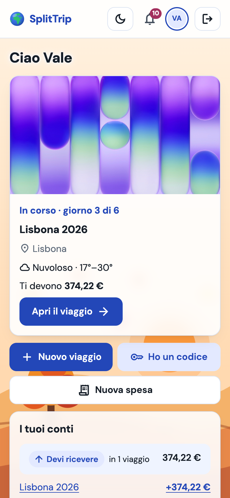
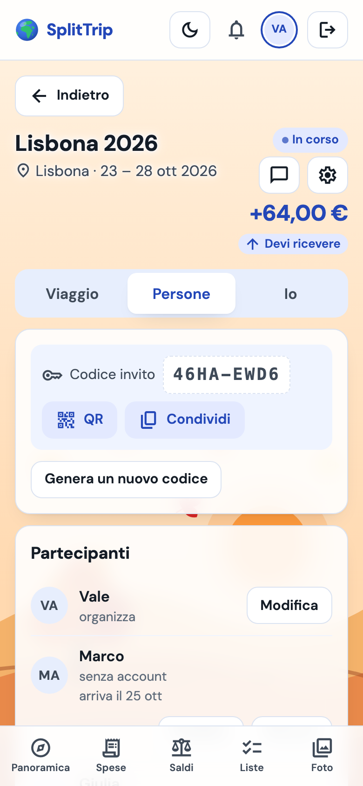
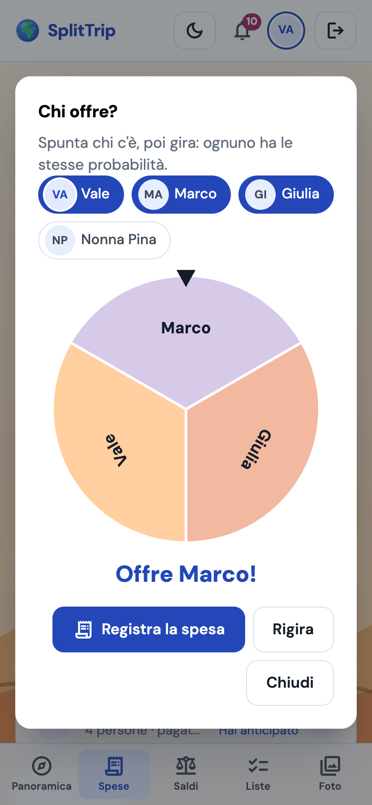
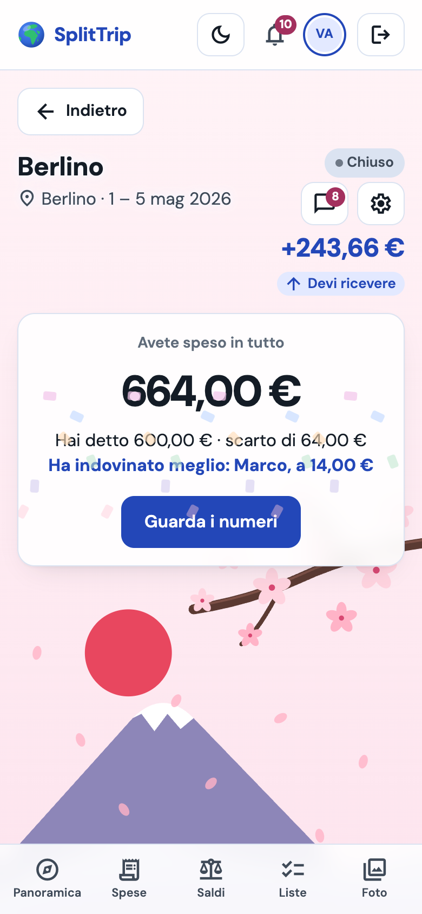
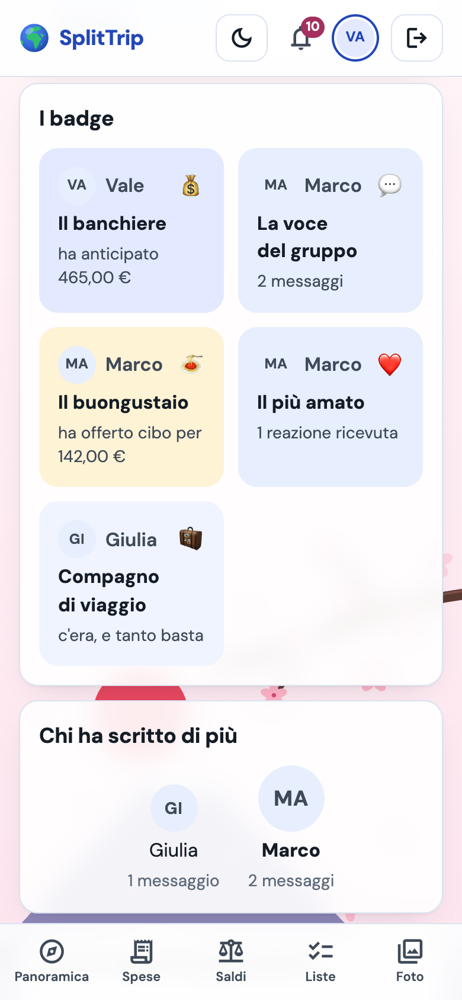
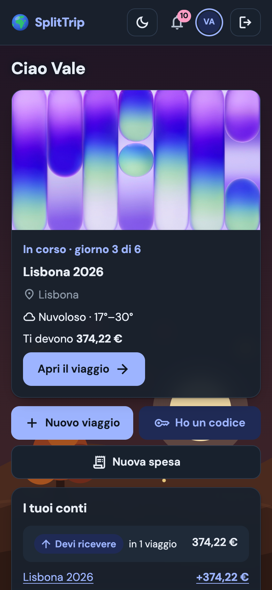
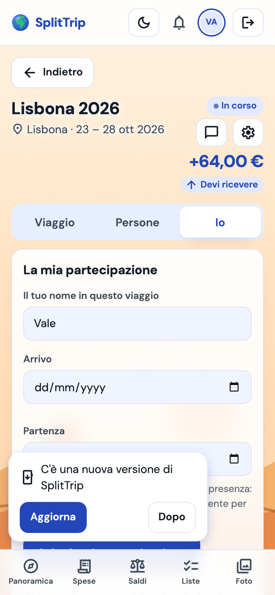
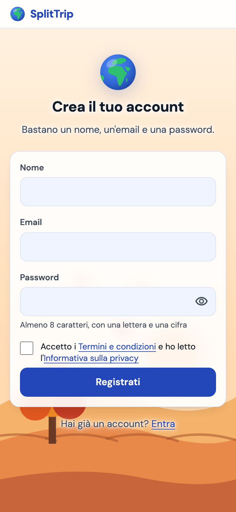
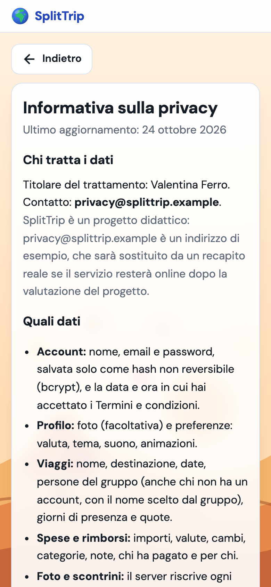

# 🧳 SplitTrip

[](https://github.com/Valelearn1/SplitTrip/actions/workflows/ci.yml)

> **Accompagnare i gruppi di amici in ogni fase della vacanza:** pianificare insieme prima di partire, tenere traccia di spese e cose da fare durante, e ritrovarsi con ricordi condivisi e conti chiari al ritorno.

🔗 **Demo:** https://splittrip-750q.onrender.com
📘 **API (Swagger):** https://splittrip-api.onrender.com/swagger-ui.html

> ⏳ Il backend gira sul piano gratuito di Render: dopo un periodo di inattività si addormenta e la **prima richiesta può impiegare fino a un minuto**. L'app lo segnala con un avviso «Il server si sta svegliando…».

Progetto finale (capstone) del corso fullstack: frontend React + TypeScript, backend Java Spring Boot, PostgreSQL.

---

## ✨ Cosa fa

- 🔐 **Registrazione e login** con JWT
- ✈️ **Viaggi** con stato (in pianificazione → in corso → chiuso) e **codice invito** da condividere su WhatsApp
- 💸 **Spese** divise in parti uguali (dove qualcuno può **contare per 2**, la coppia con un solo telefono, **o per ½**, il bambino), con importi personalizzati o **per presenza** (notti o giorni: chi arriva dopo paga meno alloggio), con l'anteprima delle quote
- 👵 **Partecipanti senza account**: l'organizzatore aggiunge chi non usa l'app, che ha comunque la sua quota; se poi si registra, entrando col codice **rivendica il suo posto** e ritrova le sue spese
- 🧳 **La mia partecipazione**: ognuno imposta per quante persone conta e le date di arrivo e partenza, o lascia il viaggio senza perdere lo storico
- ⚖️ **Saldi** sempre aggiornati e **trasferimenti suggeriti**: il minimo di rimborsi per azzerare i debiti del gruppo
- 🔁 **Rimborsi** registrabili con un tap da «Salda»
- 🗑️ **Cestino** delle spese con ripristino (organizzatore)
- 🔒 Viaggio chiuso in **sola lettura**: i conti restano consultabili
- ✅ **Liste del gruppo** («Da portare (insieme)» e «Da fare»): per ogni voce si decide, se serve, **chi la porta** o chi se ne occupa, e il filtro «Solo quelle per me»
- 📷 **Foto del viaggio** in griglia e **sulla mappa** (OpenStreetMap): la posizione GPS si mostra solo se chi carica lo sceglie
- 🧾 **Scontrino** fotografato e allegato alla spesa
- 🔔 **Notifiche** in-app: nuova spesa, rimborso ricevuto, nuovo partecipante, voce assegnata a te
- 🌤️ **Meteo della destinazione** nei giorni del viaggio (Open-Meteo)
- 🙂 **Foto profilo**, visibile solo a chi viaggia con te
- 💬 **Chat di gruppo in tempo reale** per ogni viaggio: «sta scrivendo…», messaggi eliminabili, e le spese appena aggiunte compaiono in chat con il link
- 🔔 **Campanella live**: la notifica arriva subito, senza ricaricare la pagina
- ✨ **Consigli AI** per la destinazione e **valigia suggerita** in base a meteo e durata (si aggiunge solo ciò che spunti)
- 📷 **Scatta foto** direttamente dalla fotocamera del telefono
- 🔊 **Messaggi che si notano**: suono breve (disattivabile) e avviso «Marco: …» con «Apri la chat» quando sei in un'altra pagina
- 🔎 **Dettagli a portata di tocco**: ogni spesa e rimborso si espande per leggere quote e note per intero
- 📩 Piccole animazioni con uno scopo: la busta che si apre leggendo una notifica, la valigia che si chiude a lista completata (spente con «riduci movimento»)
- 🏠 **Home con il viaggio in evidenza**: a che punto è («giorno 3 di 6»), il meteo di oggi, quanto ti devono o devi in tutti i viaggi e le ultime novità; prima del login, una **pagina di presentazione**
- 📍 **Proposte di luoghi** mentre scrivi la destinazione (e il luogo delle foto senza GPS), in italiano, con il testo libero sempre valido
- 👋 **Benvenuto nel viaggio**: chi entra con il codice sceglie subito per quante persone conta e quando arriva
- ⚙️ **Impostazioni in tre schede** (Viaggio · Persone · Io) e **profilo completo**: nome, email, password, «i miei numeri» con la mappa delle destinazioni e preferenze che valgono su ogni dispositivo (suono, animazioni, valuta predefinita)
- 👍 **Reazioni ai messaggi** (👍 ❤️ 😂 😮 😢 🎉) in tempo reale e **griglia emoji** nel campo della chat
- 🎡 **«Chi offre?»**: una ruota nei colori della stagione sceglie a caso chi paga il giro e apre la spesa già compilata
- 🎉 **Riepilogo di fine viaggio**: prima **«Indovina il totale»** (un'ipotesi a testa, dal proprio telefono), poi quanto avete speso e dove, i record, i momenti sulla mappa, **un badge a testa** e classifiche divertenti (mai sui soldi)
- 📲 **Immagine per le storie** 1080×1920 creata nel browser e condivisa dal telefono: solo il totale del gruppo e i badge, nessun saldo personale
- 🌙 **Tema chiaro, scuro o automatico** con luna/sole nell'intestazione, salvato sull'account
- 🌸 **Sfondo che segue la stagione del viaggio**: sakura in primavera, spiaggia d'estate, colline d'autunno, montagne innevate d'inverno (al contrario sotto l'equatore)
- 🔑 **Password dimenticata**: un link via email (Brevo) valido 30 minuti, una volta sola; e l'**occhiolino** per vedere la password mentre la scrivi
- 🔢 **Importi a prova di dito**: un tasto sbagliato (lettera, separatore in più, terzo decimale, settima cifra) viene ignorato invece di cambiare il numero; «1.234,56» si legge giusto, scritto o incollato; oltre 999.999,99 lo dice un messaggio
- 📍 **Destinazioni reali**: il viaggio si crea scegliendo un luogo dall'elenco, così meteo, mappa e stagione sono quelli giusti
- 📲 **App installabile e offline**: si installa dal Profilo (su iPhone con «Aggiungi alla schermata Home») e, senza rete, mostra gli ultimi viaggi, spese, saldi, liste, chat e foto già visti con «Sei offline · dati delle HH:MM»; le modifiche tornano con la rete, e una barra avvisa quando c'è una versione nuova
- ↩️ **«Indietro» su ogni pagina**; dopo un salvataggio si torna da dove si era partiti, senza rientrare nel modulo
- ♿ **Accessibile e verificata**: interfaccia mobile-first, ogni importo ha segno e testo («devi dare / devi ricevere»), mai solo il colore; controlli automatici di accessibilità (axe) in ogni pagina, verifica a mano con tastiera, lettore di schermo, zoom e filtri per il daltonismo; segue testo grande, contrasto aumentato e colori forzati del sistema
- 💱 **Spese e rimborsi in altre valute**: scegli la valuta dello scontrino, il cambio BCE del giorno arriva precompilato (o lo scrivi tu) e i conti restano nella valuta del viaggio («2.000 JPY ≈ 11,25 €»)
- 🖼️ **Copertina del viaggio**: chiunque sia nel viaggio sceglie la foto di copertina dalla galleria; nella Home si tocca per entrare nel viaggio
- 📱 **QR dell'invito**: il codice del viaggio anche come QR, da inquadrare col telefono (funziona anche offline)
- 🗣️ **Linguaggio senza genere**: nessun testo dà per scontato chi legge («chi organizza», «Dividete le spese, non le amicizie»)
- ⚖️ **Termini e condizioni e informativa sulla privacy** leggibili anche senza account: chi tratta i dati, quali fornitori li ricevono e cosa, nessun cookie; alla registrazione la casella «Accetto i Termini», con data e ora salvate (D-72, D-73)

## 📸 Screenshot

| Home | Dashboard del viaggio | Nuova spesa |
|---|---|---|
|  |  |  |

| Saldi | Liste condivise | Foto sulla mappa |
|---|---|---|
|  |  |  |

| Chat del viaggio | Impostazioni del viaggio | «Chi offre?» |
|---|---|---|
|  |  |  |

| «Indovina il totale» | Riepilogo: badge e classifiche | Tema scuro |
|---|---|---|
|  |  |  |

| App installata: avviso di nuova versione | Registrazione con i termini | Informativa sulla privacy |
|---|---|---|
|  |  |  |


## 🗺️ Roadmap

| Versione | Contenuto | Stato |
|---|---|---|
| **v1 Core** | auth, viaggi, spese, rimborsi, saldi | ✅ |
| **v1.5 Divisioni smart** | divisione per presenza e «conta per» (ex peso; tolto dall'interfaccia il 25 ottobre, D-75), partecipanti senza account rivendicabili, modello dati pronto per multi-valuta | ✅ |
| **v2 Social** | liste condivise con assegnatario, foto con mappa, scontrino sulla spesa, notifiche in-app, meteo, foto profilo | ✅ |
| **v3 Live** | chat di gruppo e notifiche in tempo reale (WebSocket STOMP), consigli AI, movimento | ✅ |
| **v3.1 Rifinitura** | dai test con gli amici: proposte di luoghi, benvenuto, Impostazioni a schede, Home e presentazione, profilo con preferenze, reazioni ed emoji in chat | ✅ |
| **v3.2 Giochi, riepilogo e tema** | «Chi offre?», riepilogo di fine viaggio con «Indovina il totale», badge e immagine per le storie, tema scuro, palette cobalto e lampone, sfondo stagionale, logo mappamondo, «Indietro» ovunque, password dimenticata, importi solo numerici, destinazioni reali | ✅ |
| **v3.3 Inclusiva** | accessibilità verificata (WCAG 2.2 AA), linguaggio senza genere, impostazioni di sistema, ritocchi | ✅ |
| **v3.4 Qualità e demo** | CI su GitHub Actions, giro end-to-end con Playwright, QR dell'invito, ultimi ritocchi di accessibilità | ✅ |
| **v3.5 App installabile e offline** | PWA installabile, consultazione offline in sola lettura, foto già viste, avviso «Aggiorna», dati cancellati all'uscita | ✅ |
| **v3.6 Valute** | spese e rimborsi in altre valute col cambio del giorno salvato, valute senza centesimi, tetti per valuta | ✅ |

La visione di prodotto oltre il capstone (ospiti senza registrazione, spese in altre valute, offline, scontrino diviso per voce): [`docs/ROADMAP.md`](docs/ROADMAP.md).

## 🏗️ Stack

| Livello | Tecnologie |
|---|---|
| **Backend** | Java 25, Spring Boot 4.1 (WebMVC, Data JPA / Hibernate 7, Security 7 + OAuth2 Resource Server, Validation, Actuator), Flyway, springdoc-openapi, ImageIO + TwelveMonkeys (WebP), WebSocket STOMP (broker in memoria), API di Anthropic (Claude Haiku) |
| **Database** | PostgreSQL 16 |
| **Frontend** | React 19, TypeScript, Vite, React Router, TanStack Query (con persistenza in IndexedDB, idb-keyval), React Hook Form + Zod, date-fns, react-leaflet + OpenStreetMap, exifr, @stomp/stompjs, Motion, vite-plugin-pwa (Workbox) |
| **Design** | DM Sans, Material Symbols, token CSS (nessun framework CSS) — sistema documentato in [`DESIGN.md`](DESIGN.md) |
| **Test** | JUnit 5, Mockito, Testcontainers, MockMvc · Vitest, Testing Library, MSW |
| **Deploy** | Render (backend Docker, frontend statico, Postgres) via [`render.yaml`](render.yaml) |

## 🚀 Avvio in locale

**Prerequisiti:** Java 25, Node 24, Docker.

```bash
git clone https://github.com/Valelearn1/SplitTrip.git
cd SplitTrip

# 1. Database (porta 5432)
docker compose up -d db

# 2. Backend → http://localhost:8080 (Swagger su /swagger-ui.html)
cd BE && sh mvnw spring-boot:run

# 3. Frontend → http://localhost:5173 (in un altro terminale)
cd FE && npm ci && npm run dev
```

Flyway crea le tabelle al primo avvio. Il frontend inoltra `/api` al backend tramite il proxy di Vite.

> 💡 Se sulla porta 5432 gira già un altro Postgres (es. Homebrew: `brew services stop postgresql@18`), fermalo o cambia la porta in `docker-compose.yml`.

### Variabili d'ambiente

Tutte hanno un valore di default per lo sviluppo: in locale non serve impostarne nessuna.

| Variabile | Dove | Default in sviluppo | In produzione |
|---|---|---|---|
| `DATABASE_URL` | BE | `jdbc:postgresql://localhost:5432/splittrip` | dal database Render (formato `postgresql://…`, convertito in automatico) |
| `JWT_SECRET` | BE | segreto di sviluppo | generato da Render, almeno 32 byte |
| `CORS_ORIGIN` | BE | `http://localhost:5173` | URL del frontend |
| `VITE_API_URL` | FE | `/api` (proxy Vite) | URL dell'API |
| `ANTHROPIC_API_KEY` | BE | vuota (consigli AI spenti) | chiave Anthropic, inserita a mano su Render |
| `BREVO_API_KEY` | BE | vuota (nessuna email) | chiave API di Brevo con il solo permesso d'invio delle email transazionali, inserita a mano su Render |
| `MAIL_FROM` | BE | vuota | mittente verificato su Brevo |
| `MAIL_LOG_LINKS` | BE | `false` | mai in produzione; in locale `true` scrive nel log il link di «Password dimenticata» |

## 🧪 Test

```bash
cd BE && sh mvnw test   # 259 test: unitari + integrazione con Postgres reale (serve Docker)
cd FE && npm test       # 383 test
docker compose up -d db-e2e && cd FE && npm run e2e   # giro completo in un browser vero (Playwright)
```

Cosa coprono:
- ⚖️ **motore dei saldi** al 100 %: somma dei netti sempre zero, centesimi di resto deterministici, al massimo n−1 trasferimenti
- 🧮 **divisione per presenza e per peso (il motore)**: stessi esempi di riferimento nel backend e nel frontend (resto maggiore, Σ quote = totale)
- 🗃️ **migrazione dei dati**: test che applica la V1, inserisce dati reali (anche un ex membro nel cestino) e verifica la V2
- 🔄 **flussi API end-to-end** su Postgres reale (Testcontainers): registrazione → viaggio → invito → spese → rimborsi → saldi
- 🔒 **sicurezza**: 401/403, SQL injection, XSS, id utente preso solo dal token, nessuno stack trace negli errori
- 🖼️ **immagini**: riscrittura lato server (niente EXIF), PNG trasparente su bianco, file finti rifiutati, limite di dimensione e di numero
- 🔔 **notifiche**: un evento per azione, mai a chi l'ha fatta, scritte solo dopo il commit
- 🌤️ **meteo**: servizio giù o lento → card vuota, mai un errore
- ⚡ **tempo reale** con un client STOMP vero: CONNECT senza token rifiutato, canale di un viaggio solo ai membri, notifica solo al destinatario, «sta scrivendo» limitato; nel frontend riconnessione, logout e nessun messaggio doppio
- ✨ **AI**: nel testo per il modello niente nomi né email, risposta rotta → 503 senza consumare il limite, 5 generazioni al giorno
- 📍 **luoghi**: testo con caratteri speciali codificato bene, servizio giù → nessuna proposta ma testo libero valido, 30 ricerche al minuto, cache
- 👍 **reazioni**: idempotenti, due persone insieme → il canale mostra entrambe, emoji fuori lista rifiutata
- 👤 **account**: email unica, password attuale obbligatoria, la sessione aperta resta valida dopo il cambio
- 🎡 **giochi e riepilogo**: la ruota si ferma sullo spicchio annunciato, chi non ha account parte non spuntato; badge con pari merito a chi è entrato prima e zero che non vince; due ipotesi inviate insieme → una sola riga; classifiche nascoste se tutto è a zero; immagine per le storie con ritaglio 9:16 e nomi lunghi accorciati
- 🎨 **colori**: contrasto AA verificato dai test per ogni coppia testo/fondo nei due temi, anche sul vetro sopra l'illustrazione più sfavorevole e sui pastelli della ruota
- 🔑 **ripristino password**: email sconosciuta senza email, link monouso, scaduto o inventato rifiutato, un link nuovo annulla il vecchio, token mai salvato in chiaro, richiesta all'API di Brevo verificata con un server finto
- 🔢 **importi**: il campo provato un tasto alla volta (punto di troppo, migliaia, decimali, settima cifra) e incollando, tetto 999.999,99 uguale nel browser e nel server
- ↩️ **«Indietro»**: pagina madre per ogni rotta, ritorno nella cronologia, moduli salvati che non restano indietro
- 📶 **offline**: cosa si salva e cosa no, marchio per persona, cancellazione all'uscita anche con IndexedDB bloccata, app aperta già in modalità aereo, barra con l'età dei dati, pagine mai aperte, modifiche bloccate senza coda, foto e mappa senza rete, installazione e aggiornamento
- ♿ **accessibilità**: axe dentro i test di tutte le 22 pagine (0 violazioni), testo in `rem`, blocchi per contrasto aumentato e colori forzati, Dynamic Type su iOS
- 🗣️ **linguaggio**: un test nel frontend e uno nel backend bloccano le forme col genere («Bentornata», «organizzatore», «sei stato/a»…) nei testi a schermo, nei messaggi del server, nelle email e nelle istruzioni all'AI
- 💱 **valute**: conversione a 2 decimali, quote in yen che sommano al centesimo in euro, cambio zero o con troppi decimali rifiutato, servizio dei cambi finto (fine settimana → venerdì, valuta sconosciuta → 404, giù → 503), rimborso parziale in yen nei saldi, rimborsi vecchi invariati (V10)
- 🧭 **giro completo** (Playwright, in CI a ogni push): due persone si registrano, viaggio, invito col QR, spesa, saldo e «Salda», poi una spesa in yen; alla prima esecuzione ha trovato due errori sui soldi (D-66)
- 🖥️ **frontend**: client API, rotte protette, form spesa (validazione delle quote), saldi e «Salda», liste, caricamento foto col consenso alla posizione, campanella, chat, consigli AI, busta e valigia

Sviluppato in **TDD**: ogni test è stato visto fallire prima di scrivere il codice.

## 🔒 Sicurezza e privacy

| Rischio | Difesa |
|---|---|
| **SQL injection** | JPA con query parametrizzate, nessuna concatenazione di stringhe |
| **XSS** | escape automatico di React, `Content-Security-Policy` e `X-Content-Type-Options` sulla pagina dell'app (header del sito statico in `render.yaml`), lunghezze massime lato server |
| **CSRF** | API stateless con JWT nell'header `Authorization` (nessun cookie di sessione); CORS limitato al frontend — motivazione in [`docs/decisioni.md`](docs/decisioni.md) (D-17) |
| **Brute force** | rate limiting su login e registrazione (10 tentativi/minuto per IP; dietro il proxy di Render l'IP si legge dall'header di Cloudflare) |
| **Password** | BCrypt, mai in chiaro; messaggio di errore generico al login |
| **Dati personali** | solo email e nome; il token contiene solo l'id utente; segreti in variabili d'ambiente; HTTPS su Render |
| **Autorizzazione** | ogni operazione verifica l'appartenenza al viaggio; l'id utente viene sempre dal token, mai dal body |
| **Immagini** | il server decodifica e riscrive ogni foto in JPEG (via EXIF e metadati, file finti rifiutati dal contenuto, non dal nome); la posizione si salva solo con il consenso esplicito di chi carica; le immagini si scaricano con il token (`Authorization: Bearer`), mai da URL pubblici; limiti di 3 MB a file e 200 foto a viaggio |
| **Tempo reale** | il JWT viaggia nel frame CONNECT del WebSocket, mai nell'URL; ogni sottoscrizione verifica che tu sia membro del viaggio; si scrive solo via REST (stessi controlli delle API), il socket spinge dati già salvati; limite di 20 messaggi al minuto e frame da 8 KB |
| **Luoghi** | le proposte passano dal backend (Open-Meteo, D-51): al servizio arriva solo il testo cercato, mai chi sei; solo per chi ha fatto il login, 30 ricerche al minuto, risultati in cache |
| **Ripristino password** | risposta sempre uguale (nessuno scopre chi è registrato); token casuale da 32 byte, valido 30 minuti e una volta sola, salvato solo come hash SHA-256; un link nuovo annulla i precedenti; per account al massimo un'email al minuto e cinque al giorno; email spedita dopo il salvataggio, su un thread a parte, con l'API di Brevo (chiave solo nelle variabili d'ambiente, permesso minimo); stesso limite anti-forza-bruta dell'accesso |
| **Account** | cambio password solo con quella attuale, stesse regole della registrazione; email unica (senza distinzione di maiuscole); preferenze sull'account, nessun dato in più |
| **Dati sul dispositivo** | offline restano sul telefono solo le risposte già viste (in IndexedDB, marchiate con versione e persona) e le foto già aperte; mai il JSON nella cache del service worker; all'uscita dall'account tutto viene cancellato; sul telefono di altri, esci sempre |
| **Riepilogo e immagine** | il riepilogo si apre solo a viaggio finito e solo ai membri; un'ipotesi a testa, non modificabile, e quelle degli altri si vedono solo dopo la propria; l'immagine per le storie si disegna nel browser con il totale del gruppo e i badge, senza saldi personali, e non passa dal server |
| **AI** | al modello vanno solo destinazione, date, numero di persone, meteo e voci della valigia: mai nomi, email o importi; la chiave sta solo nelle variabili d'ambiente di Render; la risposta è JSON validato e mostrato come testo, le voci si aggiungono solo se le spunti; 5 generazioni al giorno per viaggio |

## 📐 Progettazione

Il progetto è sviluppato con un metodo **spec-driven**: prima la specifica, poi il piano, poi il codice.

| Documento | Contenuto |
|---|---|
| [`docs/superpowers/specs/`](docs/superpowers/specs/) | specifiche di design: v1 (modello dati, motore dei saldi, API, sicurezza, frontend), v1.5 (partecipanti, peso e presenza) v2 (liste, foto, notifiche, meteo), v3 (chat in tempo reale, AI, movimento), v3.1 (rifinitura dai test con gli amici), v3.2 (giochi, riepilogo, tema e stagioni), v3.3 (inclusiva) e v3.5 (app installabile e offline) |
| [`docs/superpowers/plans/`](docs/superpowers/plans/) | piani di implementazione task per task |
| [`docs/decisioni.md`](docs/decisioni.md) | registro delle decisioni, con alternative scartate e motivazioni |
| [`PRODUCT.md`](PRODUCT.md) · [`DESIGN.md`](DESIGN.md) | prodotto e sistema visivo |
| [`docs/accessibilita-verifica.md`](docs/accessibilita-verifica.md) | registro della verifica di accessibilità: controlli automatici, prove a mano, problemi trovati e risolti |
| [`docs/costi-operativi.md`](docs/costi-operativi.md) | costi operativi: servizi usati, costi unitari, tre scenari (oggi, uso piccolo, lancio), rischi e modello di business (Pass viaggio) |
| [`docs/scelte-tecniche.md`](docs/scelte-tecniche.md) | perché così: le scelte logiche e tecniche come domande e risposte, con il confronto puntuale col programma del corso (Vite e non CRA, TanStack Query e non Redux, CSS puro e non Bootstrap, Leaflet e non Google Maps, niente 2FA, OCR o RAG e perché), le alternative scartate e i limiti noti |
| [`docs/stitch/`](docs/stitch/) | schermate di riferimento generate con Stitch |
| [Board Trello](https://trello.com/b/rel5oKVP/splittrip) | una card per task, con obiettivo, riferimenti a spec e piano, dipendenze, «fatto quando» e messaggio di commit; una lista per versione |

## 📂 Struttura del repository

```
SplitTrip/
├── BE/                         backend Spring Boot
│   ├── src/main/java/com/splittrip/
│   │   ├── auth/               JWT, sicurezza, registrazione e login
│   │   ├── user/               utenti, foto profilo, profilo, preferenze, «i miei numeri»
│   │   ├── trip/               viaggi, membri, codice invito, controllo accessi
│   │   ├── expense/            spese, quote, rimborsi, motore dei saldi
│   │   ├── todo/               liste condivise e voci
│   │   ├── photo/              foto, scontrini, ImageProcessor
│   │   ├── notification/       notifiche (ascoltano gli eventi)
│   │   ├── weather/            meteo da Open-Meteo
│   │   ├── live/               WebSocket STOMP, JWT nel CONNECT, permessi per canale
│   │   ├── chat/               chat del viaggio, righe evento, «sta scrivendo», reazioni
│   │   ├── ai/                 consigli AI e valigia suggerita
│   │   ├── places/             proposte di luoghi (Open-Meteo), con limiti e cache
│   │   ├── home/               la Home in una chiamata
│   │   ├── wrapped/            riepilogo di fine viaggio, badge, «Indovina il totale»
│   │   └── common/             errori, configurazione, eventi
│   ├── src/main/resources/db/migration/   migrazioni Flyway
│   └── Dockerfile
├── FE/                         frontend React
│   └── src/
│       ├── app/                router, layout
│       ├── features/           auth · home · trips · expenses · balances · todo · photos · notifications · weather · profile · chat · ai · games · wrapped · pwa
│       └── shared/             client API, componenti UI, formattazione, stagioni e illustrazioni, «Indietro»
├── docs/                       spec, piani, decisioni, roadmap, screenshot
├── docker-compose.yml          Postgres locale
└── render.yaml                 deploy su Render
```

---

Fatto con ☕ e tanti test da Valentina.
